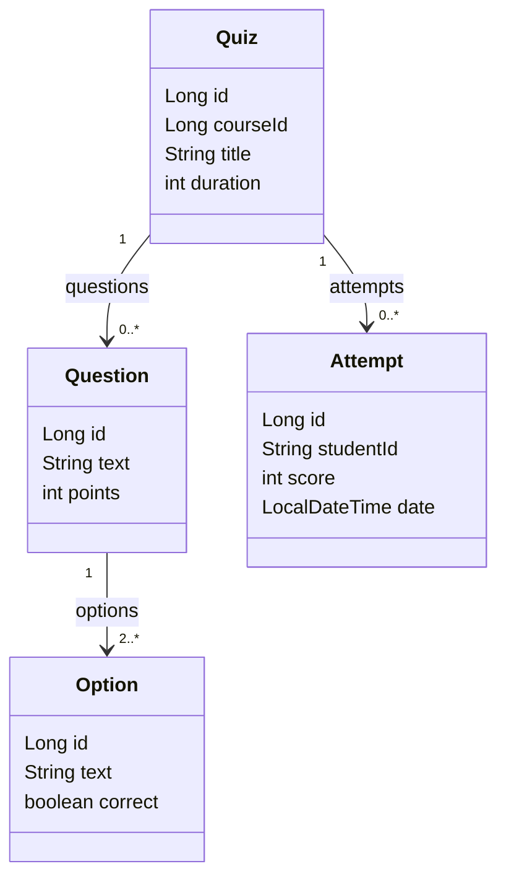
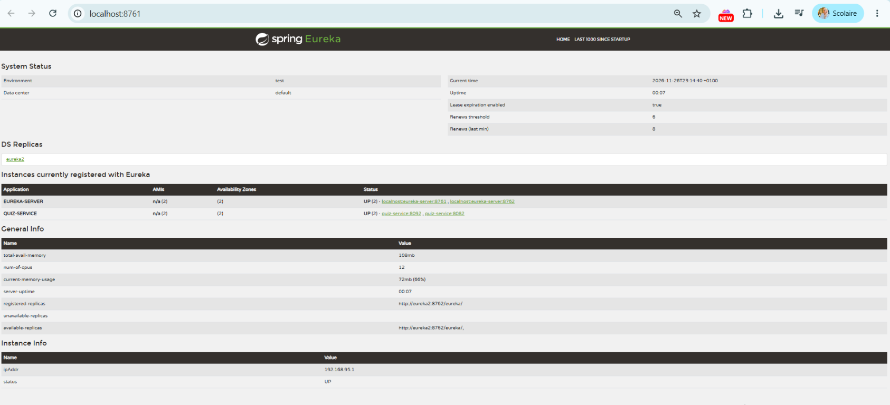
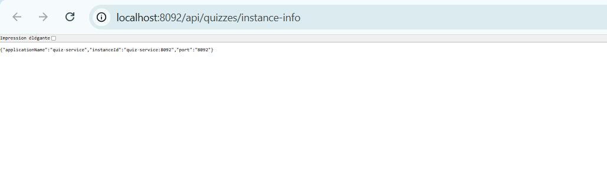
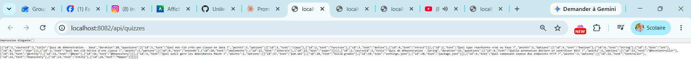
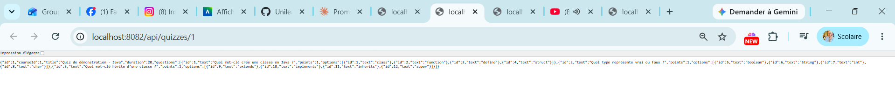
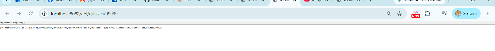
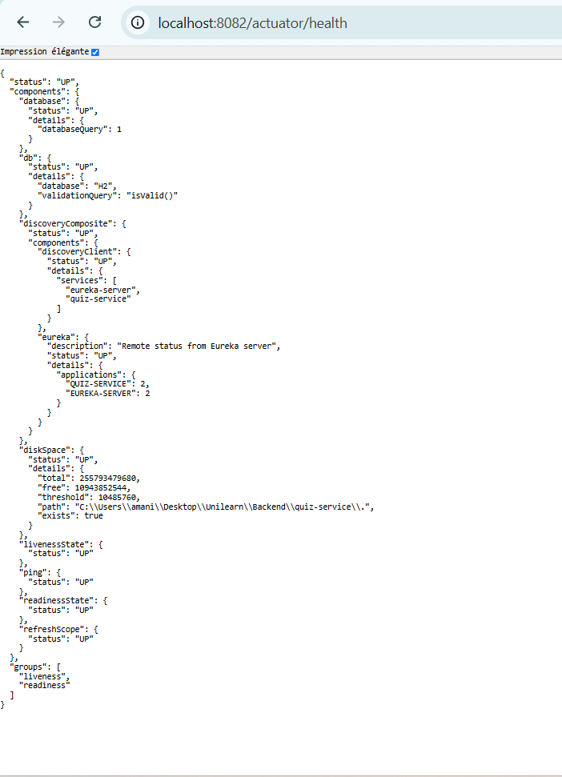
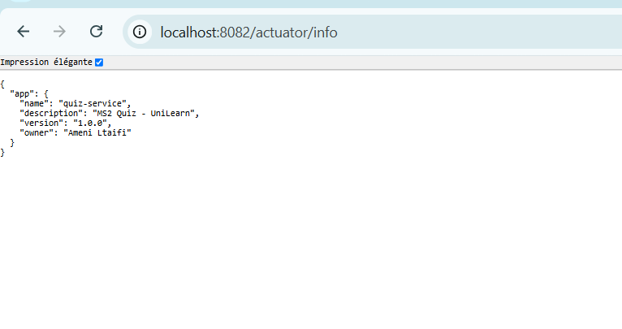
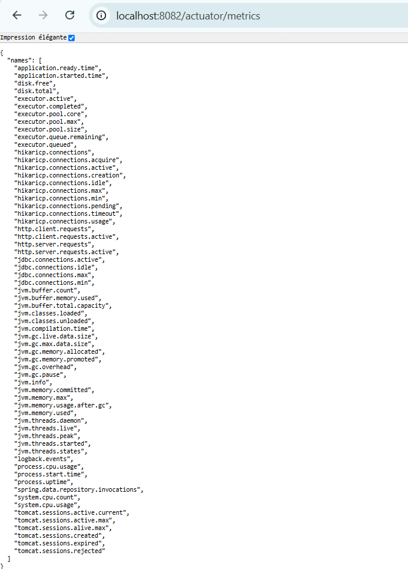

# UniLearn — MS2 Quiz

Microservice REST de création et de passage des quiz, propriétaire de sa base de données. Le compte Keycloak sera intégré plus tard : les tentatives conservent uniquement `studentId` et les quiz `courseId`.

## Stack technique

- Java 17, Spring Boot 3.2.12, Spring Cloud 2023.0.4, Maven
- Spring Web, Validation, Data JPA, Actuator, Eureka Client
- PostgreSQL 16 (Docker Compose), H2 (profil `h2`)
- JUnit 5, Mockito, Spring MVC Test

## Modèle de données

| Entité | Champs principaux | Associations |
|---|---|---|
| `Quiz` | id, courseId, title, duration (minutes) | 1-N `Question` (cascade, suppression orpheline), 1-N `Attempt` |
| `Question` | id, text, points | N-1 `Quiz`, 1-N `Option` (cascade, suppression orpheline) |
| `Option` | id, text, correct | N-1 `Question` |
| `Attempt` | id, studentId, score, date | N-1 `Quiz` |



Les contrôleurs renvoient des DTO publics : le champ `correct` n'est jamais sérialisé vers l'API étudiante. Chaque question doit contenir exactement une option correcte.

## API

Toutes les routes sont préfixées par `/api/quizzes`.

| Méthode | Route | Description | Réponses |
|---|---|---|---|
| POST | `/` | Créer un quiz avec questions/options imbriquées | 201, 400 |
| GET | `/` | Lister les quiz, filtre facultatif `?courseId=` | 200 |
| GET | `/{id}` | Lire un quiz (options sans `correct`) | 200, 404 |
| PUT | `/{id}` | Remplacer les données et questions d'un quiz | 200, 400, 404 |
| DELETE | `/{id}` | Supprimer le quiz | 204, 404 |
| POST | `/{id}/questions` | Ajouter une question | 201, 400, 404 |
| POST | `/{id}/submit` | Soumettre les réponses et calculer/enregistrer le score | 200, 400, 404, 409 |
| GET | `/{id}/results` | Lire les tentatives du quiz | 200, 404 |
| GET | `/instance-info` | Nom de l'application, port et identifiant d'instance | 200 |

Les erreurs ont le format `{ "timestamp", "status", "error", "message", "path" }`. `409 Conflict` indique qu'un étudiant a déjà passé le quiz.

## Lancement local

Prérequis : JDK 17, Maven 3.9+ et (pour PostgreSQL) Docker Desktop. Depuis `Backend/quiz-service` :

```powershell
docker compose up -d
mvn clean test
mvn spring-boot:run
```

Le service écoute sur `http://localhost:8082`. PostgreSQL utilise `quiz_db` et `quiz_user`. Modifiez au besoin les variables `POSTGRES_DB`, `POSTGRES_USER`, `POSTGRES_PASSWORD`, `QUIZ_DB_URL`, `QUIZ_DB_USERNAME` et `QUIZ_DB_PASSWORD`. Les valeurs par défaut du Compose sont réservées au développement local.

### Sans Docker (H2 et données de démonstration)

```powershell
mvn spring-boot:run "-Dspring-boot.run.profiles=h2"
```

Le profil `h2` utilise une base mémoire et insère deux quiz (trois questions et quatre options par question). Comme le profil PostgreSQL, il tente l'enregistrement à Eureka ; pour démarrer sans Eureka, ajoutez `--eureka.client.enabled=false` aux arguments.

### Deux instances enregistrées à Eureka

Ajoutez une fois dans `C:\Windows\System32\drivers\etc\hosts` (éditeur lancé en administrateur) :

```text
127.0.0.1 eureka1 eureka2
```

Dans `Backend/eureka-server`, démarrer deux terminaux :

```powershell
mvn spring-boot:run "-Dspring-boot.run.profiles=peer1"
mvn spring-boot:run "-Dspring-boot.run.profiles=peer2"
```

Puis dans `Backend/quiz-service`, lancer deux terminaux (PostgreSQL doit être prêt) :

```powershell
mvn spring-boot:run
mvn spring-boot:run "-Dspring-boot.run.arguments=--server.port=8092"
```

Les deux instances partagent le même schéma PostgreSQL, et s'enregistrent auprès des deux Eureka : `http://localhost:8761` et `http://localhost:8762`. Vérifier les ports avec `http://localhost:8082/api/quizzes/instance-info` et `http://localhost:8092/api/quizzes/instance-info`.

## Actuator et observabilité

Les endpoints exposés sont ouverts en développement. URLs de test (remplacer le port par `8092` pour la seconde instance) :

| URL | Vérification |
|---|---|
| `http://localhost:8082/actuator/health` | Santé, base de données et probes |
| `http://localhost:8082/actuator/info` | Informations du service |
| `http://localhost:8082/actuator/metrics` | Liste des métriques |
| `http://localhost:8082/actuator/metrics/http.server.requests` | Requêtes HTTP |
| `http://localhost:8082/actuator/prometheus` | Format Prometheus |
| `http://localhost:8082/actuator/mappings` | Routes exposées |
| `http://localhost:8082/actuator/env` | Environnement Spring |
| `http://localhost:8082/actuator/beans` | Beans |
| `http://localhost:8082/actuator/loggers` | Niveaux de logs |

## Tests et exemples HTTP

Exécuter `mvn clean test`. Les exemples complets REST Client sont dans [`requests.http`](requests.http); une collection importable est dans [`postman/UniLearn-Quiz.postman_collection.json`](postman/UniLearn-Quiz.postman_collection.json).

## Captures d'écran

Les captures de la démonstration sont disponibles dans [`docs/img/`](docs/img/) :

### Eureka et instances

Dashboard Eureka : deux pairs répliqués et les deux instances `QUIZ-SERVICE` enregistrées.



Réponse de l'instance Quiz sur le port 8092 :



### API Quiz

Liste des quiz de démonstration :



Détail du premier quiz :



Réponse uniforme pour un quiz introuvable (404) :



### Actuator

État de santé, base H2, découverte Eureka et probes :



Informations de l'application :



Métriques exposées :



## Intégration

L'appel OpenFeign vers MS1 n'est pas activé à ce stade. Le point d'intégration est signalé dans le contrôleur par `TODO MS1 : vérifier que le cours existe`. Aucun broker RabbitMQ n'est requis pour MS2 seul.
