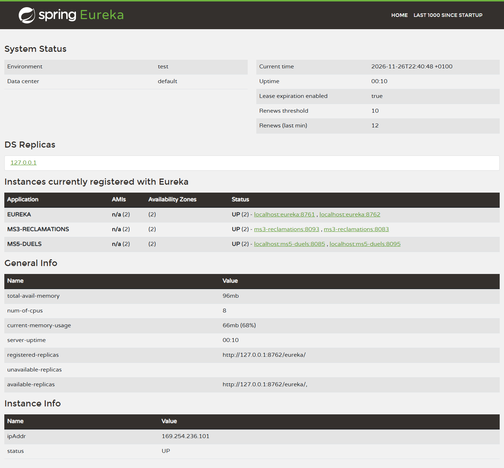

# UniLearn – Homework S5 : Eureka & Actuator

**Mohamed Rhouma** – 4SSA16 – ESPRIT 2026/2027
Projet d'équipe UniLearn (Ayoub Jleli, Ameni Ltaifi, Mohamed Rhouma, Akrem Jouini). **Mon microservice : MS3 Réclamations.**

Ce dépôt contient :
- `Backend/eureka-server` : serveur de découverte (2 instances, 8761 et 8762)
- `Backend/reclamation-service` : **mon microservice** (Spring Boot + H2)
- `Backend/duels-service` : le microservice partagé de l'équipe, en **Node.js** (technologie différente)

---

## 1. Architecture

```
          ┌───────────────────┐   réplication   ┌───────────────────┐
          │ Eureka peer1 8761 │◄───────────────►│ Eureka peer2 8762 │
          └─────────▲─────────┘                 └─────────▲─────────┘
                    │      enregistrement + heartbeat     │
        ┌───────────┴─────────────┬───────────────────────┴───┐
        │  MS3-RECLAMATIONS       │  MS5-DUELS                │
        │  8083 + 8093            │  8085 + 8095              │
        │  Spring Boot · H2       │  Node.js · Express · WS   │
        └───────────┬─────────────┴──────────────┬────────────┘
                    │ http://MS1-COURS/...        │ http://MS2-QUIZ/...
                    ▼ (si présent dans Eureka)    ▼ (si présent dans Eureka)
```

- Les deux microservices s'enregistrent auprès des **deux** serveurs Eureka.
- Chacun tourne en **2 instances** sur des ports différents.
- Les appels vers les autres services passent par leur **nom Eureka**, jamais par une IP. Si un service est absent, le mien continue de fonctionner (voir la partie 4).

| Service | Nom Eureka | Ports | Entités | Technologie |
|---|---|---|---|---|
| eureka-server | EUREKA | 8761, 8762 | – | Spring Boot |
| ms3-reclamations | MS3-RECLAMATIONS | 8083, 8093 | Claim 1..* ClaimComment | Spring Boot, JPA, H2, Actuator |
| ms5-duels | MS5-DUELS | 8085, 8095 | Duel 1..* DuelRound ; Badge 1..* UserBadge ; Notification | Node.js, Express, WebSocket |

---

## 2. Lancement

Prérequis : JDK 17+, Maven (ou IntelliJ), Node.js 18+. **Aucune base à installer** (MS3 utilise H2 en mémoire).

```bash
# 1. Deux serveurs Eureka (2 terminaux)
cd Backend/eureka-server
mvn spring-boot:run -Dspring-boot.run.profiles=peer1     # http://localhost:8761
mvn spring-boot:run -Dspring-boot.run.profiles=peer2     # http://localhost:8762

# 2. MS3 Réclamations : 2 instances
cd Backend/reclamation-service
mvn spring-boot:run                                                  # 8083
mvn spring-boot:run -Dspring-boot.run.arguments=--server.port=8093   # 8093

# 3. MS5 Duels (Node.js) : 2 instances
cd Backend/duels-service
npm install
npm start                                                            # 8085
#  PowerShell : $env:PORT=8095; npm start      cmd : set PORT=8095 && npm start
```

IntelliJ : *Run → Edit Configurations* → dupliquer `ReclamationApplication` → *Modify options → Add VM options* : `-Dserver.port=8093`.

**Vérifier :** http://localhost:8761 et http://localhost:8762 affichent **MS3-RECLAMATIONS (2 instances)**, **MS5-DUELS (2 instances)** et l'autre serveur Eureka.

---

## 3. MS3 Réclamations

**Rôle :** un étudiant dépose une réclamation sur un cours, l'enseignant la traite et chacun peut commenter.

**Entités :**
- `Claim` : id, studentId, courseId, subject, description, status, createdAt, updatedAt, courseVerified
- `ClaimComment` : id, authorId, text, date
- Association **Claim 1..* ClaimComment** : `@OneToMany(mappedBy = "claim", cascade = ALL, orphanRemoval = true)` d'un côté, `@ManyToOne` de l'autre

**Cycle de vie :**
```
OPEN ──► IN_PROGRESS ──► RESOLVED
  │            │
  └──────► REJECTED ◄────┘        RESOLVED et REJECTED sont des états finaux
```
Une transition interdite (ex. `RESOLVED → OPEN`) renvoie **409**.

**API :**
| Endpoint | Codes |
|---|---|
| `POST /api/claims` | 201, 400 |
| `GET /api/claims` · `?status=OPEN` · `?studentId=etu-001` | 200 |
| `GET /api/claims/{id}` | 200, 404 |
| `PUT /api/claims/{id}` | 200, 400, 404, 409 (déjà prise en charge) |
| `DELETE /api/claims/{id}` | 204, 404 |
| `PATCH /api/claims/{id}/status` | 200, 404, 409 |
| `POST /api/claims/{id}/comments` · `GET /api/claims/{id}/comments` | 201 / 200, 404 |
| `POST /api/claims/reverify-courses` | 200 |
| `GET /api/claims/hello` | port de l'instance qui répond |

**Organisation du code :** `controller` (API) → `service` (règles métier et transitions) → `repository` (Spring Data JPA) → `entity`. `dto` contient les requêtes validées (`@NotBlank`, `@NotNull`) et `exception` le `@RestControllerAdvice` qui renvoie des erreurs JSON propres.

**Appel MS3 → MS1 Cours via Eureka :** au dépôt, `CourseClient` appelle `http://MS1-COURS/api/courses/{courseId}` avec un `RestTemplate` annoté `@LoadBalanced`.
- Le cours existe → `courseVerified = true`
- Le cours n'existe pas (404) → réponse **400**
- MS1 est absent ou en panne → la réclamation est **enregistrée quand même** avec `courseVerified = false`, et `POST /api/claims/reverify-courses` la revérifie plus tard. Le dépôt ne dépend jamais d'un autre service.

## 4. MS5 Duels et Badges (microservice partagé, Node.js)

- Duels entre étudiants : `POST /api/duels`, `/accept`, `/answer`, `GET /api/duels`, `DELETE /api/duels/{id}`
- CRUD des badges : `GET/POST /api/badges`, `PUT/DELETE /api/badges/{id}`, `GET /api/badges/{userId}`
- `GET /api/leaderboard`, `GET /api/notifications/{userId}`
- WebSocket `ws://localhost:8085/ws` : les événements des duels arrivent en direct
- Inscription à Eureka avec `eureka-js-client`, avec `healthCheckUrl` et `statusPageUrl` déclarés

Normalement, MS5 récupère les questions d'un duel auprès de MS2-QUIZ, qu'il trouve via Eureka (503 si MS2 est absent). **Pour la démo individuelle**, on peut fournir les questions directement dans le corps :
```json
POST http://localhost:8085/api/duels
{"challengerId":"etu-001","opponentId":"etu-002","quizId":1,
 "questions":[{"text":"Port par défaut d'Eureka ?","options":[{"text":"8761","correct":true},{"text":"8080"}]}]}
```
Ensuite : `POST /api/duels/1/accept`, puis `POST /api/duels/1/answer {"userId":"etu-001","questionId":1,"optionId":11}` et la même chose pour `etu-002` → le duel est terminé, le vainqueur gagne des points et des badges.

---

## 5. Observabilité (Actuator)

| URL | Résultat |
|---|---|
| `http://localhost:8083/actuator/health` | `db` (H2), `diskSpace`, `discoveryComposite`, `ping` et mon indicateur **`claims`** (total, ouvertes, en cours, cours non vérifiés) |
| `http://localhost:8083/actuator/info` | nom, version, description, responsable, équipe |
| `http://localhost:8083/actuator/metrics` | liste des métriques |
| `http://localhost:8083/actuator/metrics/jvm.memory.used` | mémoire JVM utilisée |
| `http://localhost:8083/actuator/metrics/http.server.requests` | COUNT, TOTAL_TIME, MAX |
| `.../http.server.requests?tag=status:200` | seulement les requêtes réussies |
| `http://localhost:8083/actuator/loggers/tn.esprit.unilearn` | niveau de log ; `POST {"configuredLevel":"DEBUG"}` le change sans redémarrer |
| `http://localhost:8085/health`, `/info` | équivalents écrits à la main pour MS5 (Node.js) |
| `http://localhost:8761/eureka/apps/MS5-DUELS` | vérifier `healthCheckUrl` / `statusPageUrl` dans le registre |

Grâce à `eureka.client.healthcheck.enabled=true`, si `/actuator/health` passe DOWN, Eureka affiche l'instance **DOWN** et les autres services ne l'appellent plus.

**Question de l'atelier – `http.server.requests` :** `COUNT` est le nombre de requêtes traitées depuis le démarrage, `TOTAL_TIME` leur durée cumulée et `MAX` la durée de la plus lente (en secondes, sur une fenêtre récente). `?tag=status:200` filtre pour ne garder que les réponses 200. _Valeurs relevées : COUNT = …, MAX = … s (à compléter avec ta capture)._

---

## 6. Captures (`Documentation/Homework-S5/`)

- `eureka-8761.png`, `eureka-8762.png` : MS3 et MS5 avec 2 instances chacun
- `ms3-health.png`, `ms3-info.png`, `ms3-metrics.png`, `ms5-health.png`




Collection Postman : `Documentation/Homework-S5/MS3_Reclamations.postman_collection.json`.

## 7. Points clés à expliquer

- **Eureka** : c'est l'annuaire des instances. Le client s'enregistre (`POST`), envoie un heartbeat toutes les **30 s** (`PUT`) et il est retiré après **90 s** sans heartbeat. À l'arrêt, il se désinscrit (`DELETE`).
- **Deux serveurs Eureka** : ils répliquent le registre, donc il n'y a plus de point unique de défaillance.
- **Découverte côté client** : `@LoadBalanced RestTemplate` choisit lui-même une instance de MS1. Côté serveur, c'est une Gateway qui choisit à la place du client.
- **Actuator** : il donne la vraie santé du service (base, disque), alors que le heartbeat dit seulement que le processus tourne.
