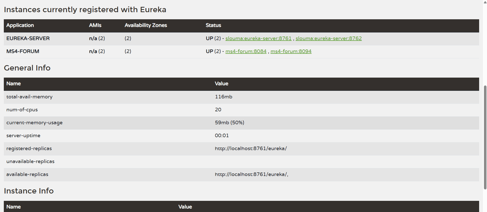
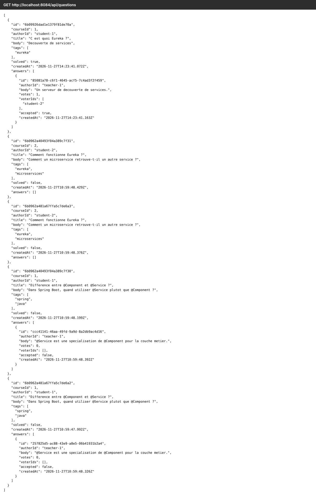

# UniLearn

UniLearn est une plateforme d’apprentissage universitaire organisée en architecture microservices. Le dépôt réunit le socle Spring Cloud, le microservice MS1 Cours et les éléments de conception destinés aux autres services.

La plateforme vise à centraliser les cours, les quiz, les réclamations, le forum Q&A, les duels éducatifs et les badges.

## Équipe et responsabilités

Membres de l'équipe : **Ayoub Jleli**, **Ameni Ltaifi**, **Mohamed Rhouma**, **Akrem Jouini**.

| Responsabilité | Microservice | Membre |
|---|---|---|
| Cours, chapitres et leçons | MS1 Cours | Ayoub Jleli |
| Quiz, questions et tentatives | MS2 Quiz | Ameni Ltaifi |
| Réclamations et suivi | MS3 Réclamations | Mohamed Rhouma |
| Forum Q&A | MS4 Forum | Akrem Jouini |
| Duels et badges | MS5 Duels & Badges | Toute l'équipe |
| Assistance et recommandations | MS6 UniLearn AI | Toute l'équipe |
| Config Server et Eureka | Socle Spring Cloud | Ayoub Jleli |
| Gateway et Keycloak | Socle Spring Cloud | Ameni Ltaifi |
| Docker Compose et RabbitMQ | Infrastructure | Mohamed Rhouma |
| Documentation et dépôt Git | Dépôt | Akrem Jouini |

## Fonctionnalités principales

### Implémentées

- Gestion des catégories et matières.
- Création, publication, archivage et consultation des cours.
- Gestion des chapitres et des leçons textuelles.
- Gestion des inscriptions des étudiants.
- Contrôle des accès pour `STUDENT`, `TEACHER` et `ADMIN`.
- Documentation OpenAPI et Swagger.
- Configuration centralisée, service registry Eureka et API Gateway.
- Migrations de base de données avec Flyway.

### Planifiées

- Quiz et tentatives.
- Réclamations et commentaires.
- Forum Q&A.
- Duels, scores, classements et badges.
- Frontend Angular.
- Service FastAPI d’assistance et de recommandations.
- Keycloak, RabbitMQ et communications interservices.

## Architecture

```text
Navigateur / Frontend
        |
        v
API Gateway :8080
        |
        +---- Eureka :8761
        +---- Config Server :8888
        |
        +---- MS1 Cours :8081
        +---- MS2 Quiz :8082
        +---- MS3 Réclamations :8083
        +---- MS4 Forum :8084
        +---- MS5 Duels & Badges :8085
        +---- MS6 UniLearn AI :8086
```

Les communications synchrones prévues utilisent OpenFeign ou des appels HTTP ciblés. Les communications asynchrones utiliseront RabbitMQ, avec des événements métier durables et idempotents.

Chaque microservice conservera ses données dans son propre stockage. Aucun microservice ne doit lire directement les tables ou collections d’un autre service.

## Technologies

- Java 17
- Spring Boot 3.5
- Spring Cloud 2025.0
- Spring Data JPA
- Spring Security OAuth2 Resource Server
- Maven
- MySQL 8
- Flyway
- H2 pour les tests d’intégration
- Testcontainers
- JUnit 5 et Mockito
- OpenAPI / Springdoc
- Docker et Docker Compose
- Keycloak, RabbitMQ et Angular en cours d’intégration
- Python 3 / FastAPI pour MS6 à venir

## Structure du dépôt

```text
UniLearn/
├── backend/
│   ├── pom.xml
│   ├── platform/
│   │   ├── config-server/
│   │   ├── eureka-server/
│   │   └── gateway/
│   └── services/
│       ├── ms1-courses/
│       └── ms4-forum/
├── docs/
│   └── architecture.md
├── infra/
│   └── config/
├── docker-compose.yml
├── .env.example
└── README.md
```

`Backend/cours-service` est conservé comme ancien squelette Gradle et archive technique indépendante. Il n’est pas converti en Maven et ne constitue pas l’implémentation fonctionnelle de MS1. Il conserve ses sources, configurations, scripts et wrapper ; le projet Maven sous `backend/` est la référence actuelle pour exécuter et développer le backend. Les deux projets déclarent le port `8081` et ne doivent pas être lancés simultanément. La migration de `Backend/` vers une arborescence canonique en minuscules est reportée jusqu’à validation d’un plan dédié.

## Prérequis

- JDK 17
- Maven 3.9 ou supérieur
- Docker Desktop pour MySQL et les tests Testcontainers
- Git
- Keycloak uniquement pour tester l’authentification complète

Sélectionnez le JDK avant les commandes Maven :

```powershell
$env:JAVA_HOME = "$env:USERPROFILE\.jdks\jbr-17.0.14"
$env:PATH = "$env:JAVA_HOME\bin;$env:PATH"
```

Adaptez le chemin ci-dessus si votre JDK 17 est installé ailleurs.

## Configuration locale

Copiez l’exemple d’environnement et renseignez uniquement des valeurs locales :

```powershell
Copy-Item .env.example .env
```

Ne commitez jamais `.env`, les mots de passe, les clés ou les credentials. Les variables utilisées par MS1 sont notamment :

- `MS1_DB_HOST`
- `MS1_DB_PORT`
- `MS1_DB_NAME`
- `MS1_DB_USER`
- `MS1_DB_PASSWORD`
- `MS1_MYSQL_PORT`
- `MYSQL_ROOT_PASSWORD`

MS1 utilise actuellement MySQL 8 comme base principale. Flyway applique les migrations au démarrage. Hibernate utilise `ddl-auto: validate` afin de vérifier que le modèle JPA correspond au schéma migré.

H2 est utilisé pour les tests rapides en compatibilité MySQL. Un test Testcontainers distinct cible MySQL 8 avec Docker.

## Démarrer MySQL pour MS1

Avec Docker Desktop actif :

```powershell
docker compose up -d mysql-ms1
docker compose ps
```

Le conteneur porte le nom `unilearn-mysql-ms1` et persiste ses données dans le volume `mysql-ms1-data`.

## Démarrer le socle Spring Cloud

Définissez le dépôt Maven local dans chaque terminal :

```powershell
$mavenRepo = Join-Path (Get-Location) '.m2\repository'
```

### 1. Config Server

```powershell
$configPath = (Resolve-Path .\infra\config).Path.Replace('\', '/')
$env:CONFIG_REPOSITORY = "file:///$configPath/"
mvn "-Dmaven.repo.local=$mavenRepo" -f backend/pom.xml -pl platform/config-server spring-boot:run
```

### 2. Eureka Server

```powershell
mvn "-Dmaven.repo.local=$mavenRepo" -f backend/pom.xml -pl platform/eureka-server spring-boot:run
```

### 3. API Gateway

```powershell
mvn "-Dmaven.repo.local=$mavenRepo" -f backend/pom.xml -pl platform/gateway spring-boot:run
```

Si le port `8080` est occupé, lancez temporairement la Gateway sur `18080` :

```powershell
$env:SERVER_PORT = '18080'
mvn "-Dmaven.repo.local=$mavenRepo" -f backend/pom.xml -pl platform/gateway spring-boot:run
```

## Démarrer MS1 Cours

Après MySQL, Config Server et Eureka :

```powershell
$mavenRepo = Join-Path (Get-Location) '.m2\repository'
mvn "-Dmaven.repo.local=$mavenRepo" -f backend/pom.xml -pl services/ms1-courses spring-boot:run
```

## Vérifier le projet

Une fois les composants actifs :

- Eureka : <http://localhost:8761>
- Config Server : <http://localhost:8888/actuator/health>
- Gateway : <http://localhost:8080/actuator/health>
- Configuration Gateway : <http://localhost:8888/gateway/default>
- MS1 health : <http://localhost:8081/actuator/health>
- MS1 Swagger : <http://localhost:8081/swagger-ui.html>
- MS1 OpenAPI : <http://localhost:8081/v3/api-docs>

Si la Gateway utilise le port alternatif, remplacez `8080` par `18080` dans les URL Gateway.

## API MS1

MS1 fournit notamment :

- Catégories : `/api/categories`
- Matières : `/api/subjects`
- Cours : `/api/courses`
- Inscriptions : `/api/courses/{id}/enrollments` et `/api/enrollments/me`
- Chapitres : `/api/courses/{id}/chapters`
- Leçons : `/api/chapters/{id}/lessons`

Les rôles JWT sont associés aux autorités `STUDENT`, `TEACHER` et `ADMIN`. Les enseignants ne gèrent que leurs propres cours ; les administrateurs peuvent gérer tous les cours.

## MS4 Forum Q&A

MS4 gère les questions du forum, leurs réponses, les votes et la réponse acceptée.

- Technologie : Spring Boot · Spring Data MongoDB · client Eureka · Actuator · Springdoc
- Base : MongoDB `unilearn_forum`, collection `questions`
- Port : `8084` · Nom Eureka : `MS4-FORUM`
- Modèle : une `Question` contient plusieurs `Answer` (sous-documents imbriqués, association 1 — *)

### Démarrer MS4

```powershell
docker compose up -d mongo-ms4
$mavenRepo = Join-Path (Get-Location) '.m2\repository'
mvn "-Dmaven.repo.local=$mavenRepo" -f backend/pom.xml -pl services/ms4-forum spring-boot:run
```

Deuxième instance (port `8094`) :

```powershell
$env:SERVER_PORT = '8094'
mvn "-Dmaven.repo.local=$mavenRepo" -f backend/pom.xml -pl services/ms4-forum spring-boot:run
```

Dans IntelliJ : Run → Edit Configurations → Copy Configuration → VM options `-Dserver.port=8094`.

MS4 s'enregistre sur les deux serveurs Eureka `8761` et `8762` (variable `EUREKA_SERVER_URL`).

### Deux serveurs Eureka (8761 et 8762)

Pour que les deux serveurs affichent tous les microservices, ils doivent se répliquer (peers). Lancer le même `eureka-server` deux fois avec ces arguments (IntelliJ : Program arguments) :

```powershell
# Eureka 1
$env:SERVER_PORT = '8761'
java -jar backend/platform/eureka-server/target/eureka-server-1.0.0-SNAPSHOT.jar --eureka.client.register-with-eureka=true --eureka.client.fetch-registry=true --eureka.client.service-url.defaultZone=http://127.0.0.1:8762/eureka/ --eureka.instance.hostname=localhost

# Eureka 2
$env:SERVER_PORT = '8762'
java -jar backend/platform/eureka-server/target/eureka-server-1.0.0-SNAPSHOT.jar --eureka.client.register-with-eureka=true --eureka.client.fetch-registry=true --eureka.client.service-url.defaultZone=http://localhost:8761/eureka/ --eureka.instance.hostname=127.0.0.1
```

`localhost` et `127.0.0.1` servent à donner deux noms d'hôte différents aux peers : avec le même nom, Eureka ne réplique pas.

### API MS4

| Méthode | URL | Codes |
|---|---|---|
| POST | `/api/questions` | 201, 400 |
| GET | `/api/questions` · `/api/questions?course={id}` | 200 |
| GET | `/api/questions/{id}` | 200, 404 |
| PUT | `/api/questions/{id}` | 200, 400, 404 |
| DELETE | `/api/questions/{id}` | 204, 404 |
| POST | `/api/questions/{id}/answers` | 201, 400, 404 |
| GET | `/api/questions/{id}/answers` | 200, 404 |
| PUT | `/api/answers/{id}` | 200, 404 |
| DELETE | `/api/answers/{id}` | 204, 404 |
| POST | `/api/answers/{id}/vote` | 200, 404, 409 |
| PATCH | `/api/answers/{id}/accept` | 200, 404 |
| GET | `/api/questions/hello` | 200 (port de l'instance) |

### Observabilité MS4 (Actuator)

- <http://localhost:8084/actuator>
- <http://localhost:8084/actuator/health> (MongoDB, Eureka, espace disque)
- <http://localhost:8084/actuator/info>
- <http://localhost:8084/actuator/metrics> et `/actuator/metrics/http.server.requests`
- <http://localhost:8084/actuator/env>, `/beans`, `/mappings`, `/loggers`
- Swagger : <http://localhost:8084/swagger-ui.html>

### Captures MS4 (Eureka et Actuator)

**Dashboard Eureka 8761** : deux serveurs Eureka (8761 et 8762) répliqués et deux instances de MS4 (`ms4-forum:8084`, `ms4-forum:8094`).


**Dashboard Eureka 8762** : le second serveur voit les mêmes instances.


**Eureka sur le poste d'un membre de l'équipe** (Windows) :



**Actuator `/actuator/health`** : MS4, MongoDB et Eureka à l'état `UP`.


**Actuator `/actuator/info`** :


**Actuator `/actuator/metrics`** :


**Actuator `/actuator/metrics/http.server.requests`** (requêtes traitées par l'API) :


**Swagger MS4** (`/swagger-ui.html`) :


**`GET /api/questions`** : questions avec leurs réponses imbriquées, votes et réponse acceptée.



## Tests

Exécutez tous les modules :

```powershell
$mavenRepo = Join-Path (Get-Location) '.m2\repository'
mvn "-Dmaven.repo.local=$mavenRepo" -B -f backend/pom.xml clean verify
```

Exécutez spécifiquement MS1 :

```powershell
$mavenRepo = Join-Path (Get-Location) '.m2\repository'
mvn "-Dmaven.repo.local=$mavenRepo" -B -f backend/pom.xml -pl services/ms1-courses -am verify
```

Les tests H2 vérifient les migrations Flyway et Hibernate. Le test Testcontainers utilise MySQL 8 et est automatiquement ignoré si Docker n’est pas disponible.

## Gestion Git

- Utilisez une branche distincte pour chaque fonctionnalité.
- Ne committez pas `.env`, `.m2/`, `target/`, les caches Gradle ou les fichiers IDE locaux.
- Avant une fusion ou un pull, vérifiez `git status` et inspectez les branches distantes.
- Ne forcez jamais l’historique sur une branche partagée.

## État d’avancement

- [x] Socle Maven et Spring Cloud
- [x] Config Server
- [x] Eureka Server
- [x] API Gateway
- [x] MS1 Cours, modèles JPA, migrations Flyway et tests
- [ ] Keycloak
- [ ] RabbitMQ
- [ ] MS2 Quiz
- [ ] MS3 Réclamations
- [x] MS4 Forum (CRUD, MongoDB, Eureka, Actuator)
- [ ] MS5 Duels et badges
- [ ] Frontend Angular
- [ ] MS6 UniLearn AI
