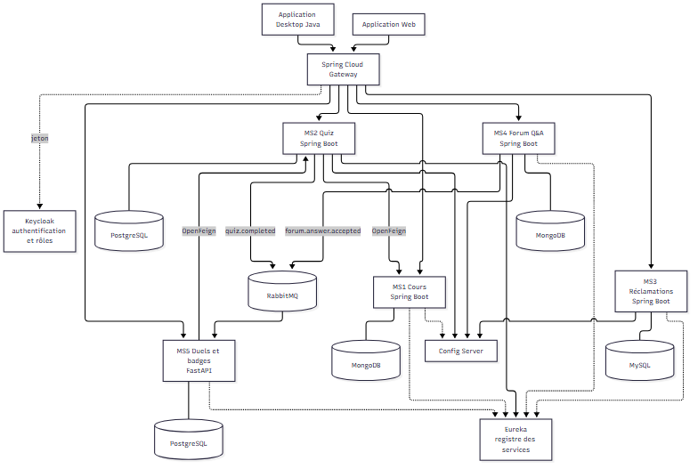

# UniLearn

Plateforme d’apprentissage universitaire (web + application desktop Java) · Module AWD · Validation 1 · 2026-2027

## Sujet

Les outils pédagogiques sont dispersés et le suivi des étudiants reste difficile. UniLearn centralise dans un seul espace : les cours (chapitres et leçons), les quiz (QCM), les réclamations et leur suivi, un forum Q&A et des duels éducatifs avec badges.

## Équipe

| Membre | Microservice |
|---|---|
| [Étudiant 1] | MS1 Cours |
| [Étudiant 2] | MS2 Quiz |
| [Étudiant 3] | MS3 Réclamations |
| [Étudiant 4] | MS4 Forum Q&A |
| Toute l’équipe | MS5 Duels et badges, Frontend |

## Architecture



Le diagramme source est dans `Documentation/Diagrams/architecture.mermaid`. Les autres diagrammes (cas d’utilisation, classes, séquence) sont dans le même dossier.

| Microservice | Technologie | Base | Port |
|---|---|---|---|
| MS1 Cours | Spring Boot | MongoDB | 8081 |
| MS2 Quiz | Spring Boot | PostgreSQL | 8082 |
| MS3 Réclamations | Spring Boot | MySQL | 8083 |
| MS4 Forum Q&A | Spring Boot | MongoDB | 8084 |
| MS5 Duels et badges | Python (FastAPI) | PostgreSQL | 8085 |

Infrastructure : Spring Cloud Gateway (8080), Keycloak (8180), Eureka (8761), Config Server (8888), RabbitMQ (5672).

## Structure du dépôt

```
Backend/          un projet par microservice + gateway, eureka, config server
Frontend/         application web et application desktop Java
Documentation/
  Presentation/   support de présentation
  Diagrams/       architecture, cas d’utilisation, classes, séquence
README.md
```

## Lancement

Prérequis : Java 17, Maven, Python 3.11, Docker et Docker Compose.

1. Démarrer l’infrastructure : `docker compose up -d` (bases de données, RabbitMQ, Keycloak).
2. Lancer dans l’ordre : Config Server, Eureka, Gateway.
3. Lancer chaque microservice : `mvn spring-boot:run` dans son dossier (MS5 : `uvicorn main:app --port 8085`).
4. Vérifier les services enregistrés sur http://localhost:8761.

## Gestion de projet

Tableau des tâches : [lien Trello ou GitHub Projects]

## Documentation

Le document technique et la présentation sont dans `Documentation/`.
