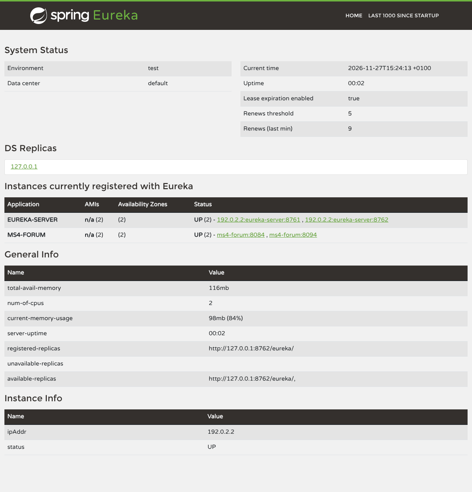
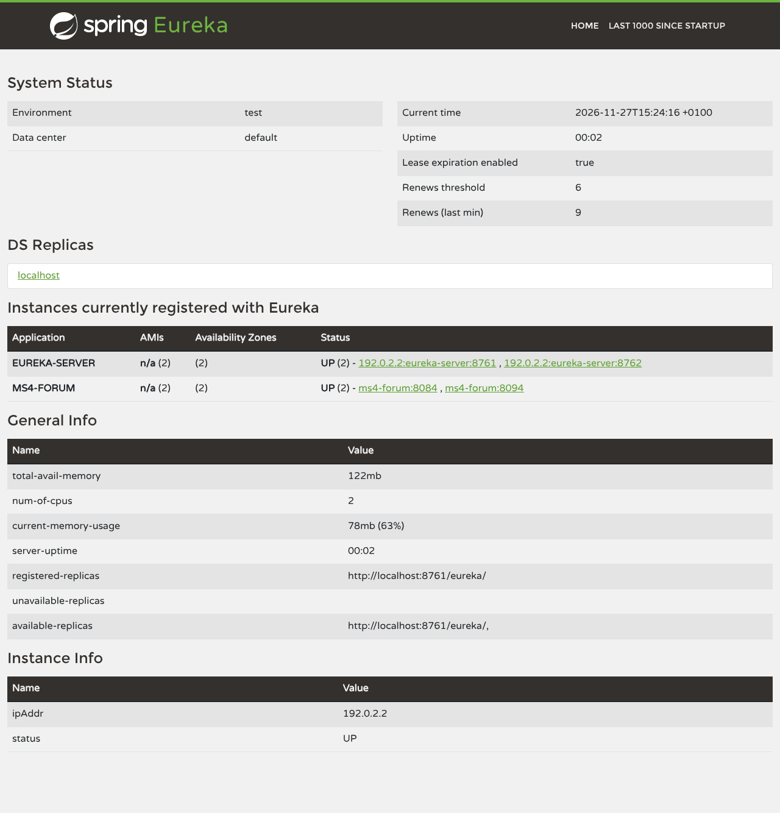
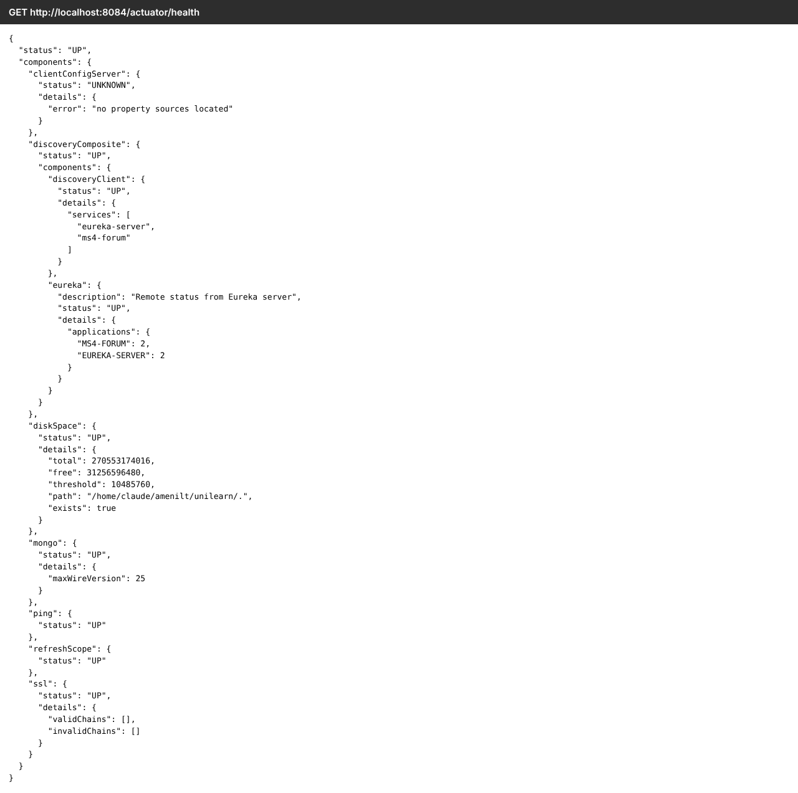
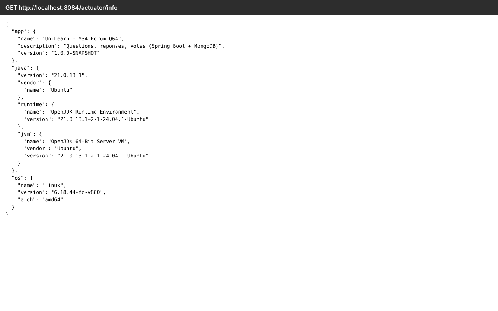
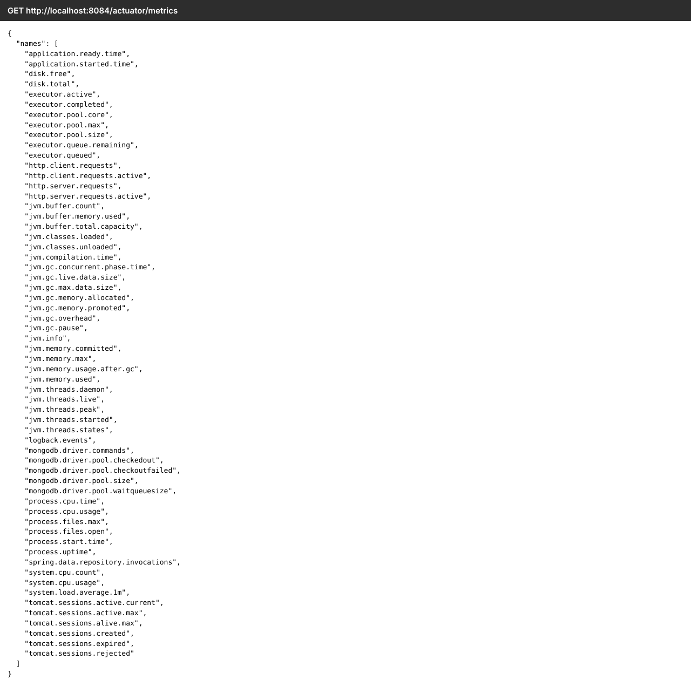
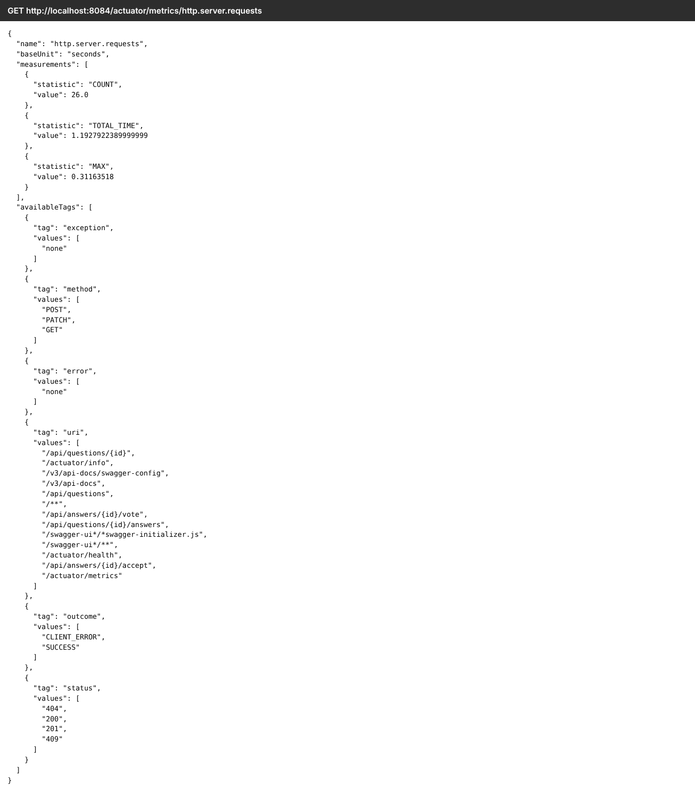
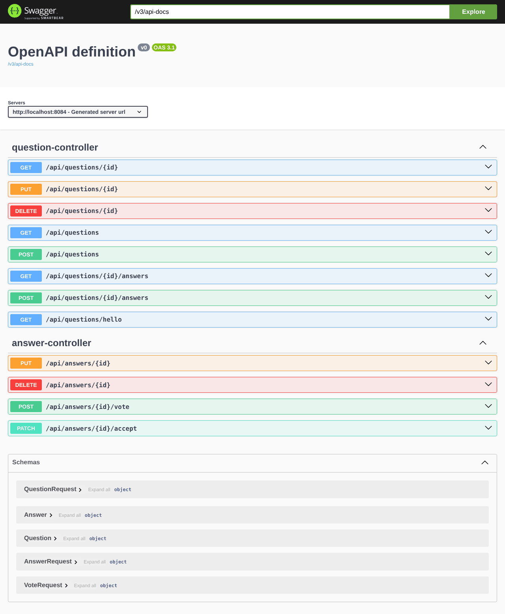

# MS4 — Forum Q&A

Microservice **Forum Q&A** de la plateforme UniLearn. Les étudiants posent des questions liées à un cours, les autres utilisateurs y répondent, votent pour les meilleures réponses, et l'auteur peut accepter une réponse pour marquer la question comme résolue.

- **Responsable** : Akrem Jouini
- **Branche** : `MS4-forum`
- **Nom Eureka** : `MS4-FORUM`
- **Port** : `8084` (deuxième instance : `8094`)

## Technologies

- Java 17, Spring Boot 3.5
- Spring Data MongoDB (base `unilearn_forum`, collection `questions`)
- Spring Cloud Netflix Eureka Client
- Spring Boot Actuator (observabilité)
- Springdoc OpenAPI (Swagger UI)
- Bean Validation (`@NotBlank`, `@NotNull`, `@Size`)
- JUnit 5 et Mockito (tests unitaires)

## Architecture

```
Client (Postman / Swagger / Frontend)
        |
        v
API Gateway (8080)  --->  Eureka (8761, 8762)
        |                      ^
        v                      | enregistrement + heartbeat
MS4 Forum (8084, 8094) --------+
        |
        v
MongoDB (27017) : unilearn_forum.questions
```

Organisation du code (`com.unilearn.ms4.forum`) :

| Package | Rôle |
|---|---|
| `entity` | Documents MongoDB : `Question` et `Answer` |
| `repository` | `QuestionRepository` (Spring Data MongoDB) |
| `service` | `ForumService` : règles métier (vote unique, réponse acceptée) |
| `controller` | `QuestionController` et `AnswerController` (API REST) |
| `dto` | Objets reçus par l'API (`QuestionRequest`, `AnswerRequest`, `VoteRequest`) |
| `exception` | Erreurs 404 / 409 / 400 au format `ProblemDetail` |
| `config` | `DataInitializer` : données de démo si la base est vide |

## Modèle de données

Une **Question** contient plusieurs **Answer** : association **1 — \*** réalisée par des sous-documents imbriqués (choix adapté à MongoDB : une question et ses réponses sont lues ensemble).

**Question** (document `questions`)

| Champ | Type | Description |
|---|---|---|
| `id` | String | Identifiant MongoDB |
| `courseId` | Long | Cours concerné (MS1), indexé |
| `authorId` | String | Auteur de la question |
| `title` | String | Titre (200 caractères max) |
| `body` | String | Contenu |
| `tags` | List<String> | Mots-clés |
| `solved` | boolean | `true` quand une réponse est acceptée |
| `createdAt` | Instant | Date de création |
| `answers` | List<Answer> | Réponses imbriquées |

**Answer** (sous-document)

| Champ | Type | Description |
|---|---|---|
| `id` | String | UUID |
| `authorId` | String | Auteur de la réponse |
| `body` | String | Contenu |
| `votes` | int | Nombre de votes |
| `voterIds` | Set<String> | Utilisateurs ayant voté (un vote par utilisateur) |
| `accepted` | boolean | Réponse acceptée |
| `createdAt` | Instant | Date de création |

Règles métier :

- un utilisateur ne peut voter qu'une seule fois pour une réponse, sinon **409 Conflict** ;
- une seule réponse acceptée par question ; accepter une réponse passe la question à `solved = true` ;
- supprimer la réponse acceptée repasse la question à `solved = false`.

## API REST

### Questions

| Méthode | URL | Description | Codes |
|---|---|---|---|
| POST | `/api/questions` | Créer une question | 201, 400 |
| GET | `/api/questions` | Lister toutes les questions | 200 |
| GET | `/api/questions?course={id}` | Questions d'un cours | 200 |
| GET | `/api/questions/{id}` | Détail d'une question | 200, 404 |
| PUT | `/api/questions/{id}` | Modifier une question | 200, 400, 404 |
| DELETE | `/api/questions/{id}` | Supprimer une question | 204, 404 |
| GET | `/api/questions/hello` | Indique le port de l'instance qui répond | 200 |

### Réponses

| Méthode | URL | Description | Codes |
|---|---|---|---|
| POST | `/api/questions/{id}/answers` | Ajouter une réponse | 201, 400, 404 |
| GET | `/api/questions/{id}/answers` | Réponses d'une question | 200, 404 |
| PUT | `/api/answers/{id}` | Modifier une réponse | 200, 400, 404 |
| DELETE | `/api/answers/{id}` | Supprimer une réponse | 204, 404 |
| POST | `/api/answers/{id}/vote` | Voter pour une réponse | 200, 404, 409 |
| PATCH | `/api/answers/{id}/accept` | Accepter une réponse | 200, 404 |

### Exemples

Créer une question :

```http
POST http://localhost:8084/api/questions
Content-Type: application/json

{
  "courseId": 1,
  "authorId": "student-1",
  "title": "C'est quoi Eureka ?",
  "body": "Je veux comprendre la découverte de services",
  "tags": ["eureka", "spring"]
}
```

Répondre, puis voter :

```http
POST http://localhost:8084/api/questions/{questionId}/answers
Content-Type: application/json

{ "authorId": "teacher-1", "body": "Eureka est un serveur de découverte de services." }
```

```http
POST http://localhost:8084/api/answers/{answerId}/vote
Content-Type: application/json

{ "userId": "student-2" }
```

Un second vote du même utilisateur renvoie :

```json
{
  "title": "Request conflict",
  "status": 409,
  "detail": "L'utilisateur student-2 a deja vote pour cette reponse"
}
```

Accepter une réponse :

```http
PATCH http://localhost:8084/api/answers/{answerId}/accept
```

## Configuration

Fichier `src/main/resources/application.yml` (valeurs locales) et `infra/config/ms4-forum.yml` (Config Server). Variables d'environnement :

| Variable | Valeur par défaut |
|---|---|
| `SERVER_PORT` | `8084` |
| `MS4_MONGO_URI` | `mongodb://localhost:27017/unilearn_forum` |
| `EUREKA_SERVER_URL` | `http://localhost:8761/eureka/,http://localhost:8762/eureka/` |
| `CONFIG_SERVER_URL` | `http://localhost:8888` (optionnel) |

Le Config Server est optionnel : sans lui, le service démarre avec sa configuration locale.

## Lancer le service

Prérequis : Java 17, Maven, MongoDB sur `localhost:27017`.

1. Démarrer MongoDB (installé en local, ou `docker compose up -d mongo-ms4` à la racine du dépôt).
2. Démarrer les deux serveurs Eureka (8761 et 8762) : voir la section « Deux serveurs Eureka » du README principal.
3. Démarrer MS4 depuis la racine du dépôt :

```powershell
mvn -f backend/pom.xml -pl services/ms4-forum spring-boot:run
```

4. Deuxième instance sur le port 8094 :

```powershell
$env:SERVER_PORT = '8094'
mvn -f backend/pom.xml -pl services/ms4-forum spring-boot:run
```

Dans IntelliJ : lancer `Ms4ForumApplication`, puis Run → Edit Configurations → Copy Configuration → VM options `-Dserver.port=8094`.

Au premier démarrage, deux questions de démo sont ajoutées si la collection est vide.

## Eureka

Les deux instances (`ms4-forum:8084` et `ms4-forum:8094`) apparaissent dans le dashboard des deux serveurs Eureka.





## Observabilité (Actuator)

Tous les endpoints Actuator sont exposés (`management.endpoints.web.exposure.include=*`), avec le détail de `health`.

| Endpoint | Contenu |
|---|---|
| `/actuator` | Liste des endpoints disponibles |
| `/actuator/health` | État du service, de MongoDB et d'Eureka |
| `/actuator/info` | Nom, description et version de l'application, Java, OS |
| `/actuator/metrics` | Liste des métriques |
| `/actuator/metrics/http.server.requests` | Requêtes HTTP traitées |
| `/actuator/env`, `/beans`, `/mappings`, `/loggers` | Configuration et internals Spring |

`/actuator/health` :



`/actuator/info` :



`/actuator/metrics` :



`/actuator/metrics/http.server.requests` :



## Swagger

Documentation interactive : <http://localhost:8084/swagger-ui.html>



## Tests

```powershell
mvn -f backend/pom.xml -pl services/ms4-forum test
```

`ForumServiceTest` vérifie : création d'une question non résolue, ajout d'une réponse, 404 sur une question inconnue, 409 sur un double vote, et passage à `solved` après acceptation.

## Évolutions prévues

- Vérifier l'existence du cours auprès de MS1 via OpenFeign (avec fallback si MS1 est indisponible).
- Publier l'événement `answer.posted` vers MS5 (Duels & Badges) via RabbitMQ.
- Sécuriser l'API avec Keycloak : l'`authorId` sera lu dans le jeton JWT.
